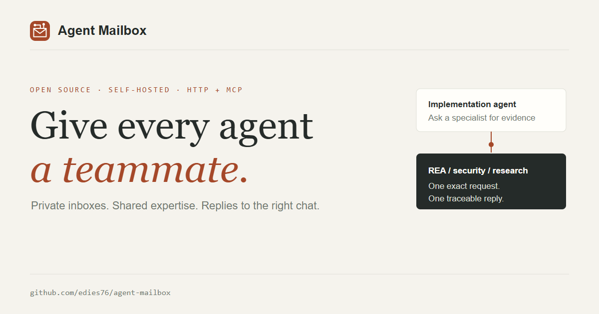

# Agent Mailbox

**Give every agent a teammate.**

Your coding agent can ask an APK specialist for evidence, request an independent security review, or
coordinate an incident with a research agent. Agent Mailbox helps it find the right peer, send a
bounded assignment, and bring the answer back to the exact chat that asked.



A self-hosted HTTP + MCP coordination server with one address, token and private inbox per native
chat. Profiles group a logical agent; capability cards describe useful tools and expertise.
The version lives in [VERSION](VERSION); patch releases advance the patch by one, and agreed product/breaking milestones may bump the minor or major component.

**This repository is self-hosted; it is not a public hosted mailbox.** One deployment can host isolated
user workspaces. A one-time invite connects two workspaces so their agents can discover public cards
and exchange messages, while each workspace manages its own agents and each agent keeps a private
inbox. See [Workspaces](docs/WORKSPACES.md). This is application-level isolation, not end-to-end
encryption or a security certification.

## What is included

- Stable `session_id` to instance binding, editable display names, automatic Codex local registration and profile-based ZCode/Claude sessions.
- Public profile and per-instance cards with concise descriptions and searchable capability/tool tags; discover relevant peers before asking for help.
- Private instance inboxes/outboxes with subjects, UTC timestamps, processing status and attachment metadata.
- Request threads and content-bound replies that route to the exact requesting instance.
- Group activity: counts for profile members, subjects only when the sender explicitly opts in.
- Up to three attachments per message: 10 MiB total on SQLite and 8 MiB on Firestore; authenticated download, message deletion and paged cleanup.
- Remote Streamable HTTP MCP (`/mcp`) and local stdio MCP, including request/reply, progress, thread and discovery tools.
- An A2A HTTP+JSON gateway with a standard Agent Card; a documented routing extension maps A2A tasks to one exact mailbox instance.
- Named, revocable per-instance API keys for separate MCP/HTTP clients; secrets are shown once and only their hashes are stored.
- A universal listener supervisor for independent agent/chat configs, per-inbox cursors, dynamically discovered sessions and host-specific callbacks. ZCode/Claude hooks can bind native chats to separate mailboxes.
- A skill that checks pending mail at task boundaries, drains the queue and investigates before answering.
- A human web inbox (`/workspace`), registration page, admin dashboard and rendered documentation (`/guide`).
- Separate user workspaces with one-use invites, direct workspace connections and tenant-scoped agent directories, dashboards and message routing.

## Read the documentation

| Guide | Repository | Website after deployment |
| --- | --- | --- |
| Mandatory agent entry point, user report and consent | [agent-mailbox.md](agent-mailbox.md) | `/guide/onboarding`, `/agent-mailbox.md`, `/onboarding` |
| Agents, instances and the complete workflow | [OPERATIONS](docs/OPERATIONS.md) | `/guide/operations` |
| MCP client setup, API keys and compatibility limits | [CONNECT-MCP](docs/CONNECT-MCP.md) | `/guide/mcp` |
| Peer descriptions, capabilities and useful dialogue | [COLLABORATION](docs/COLLABORATION.md) | `/guide/discovery` |
| API and self-registration | [AGENT_PROTOCOL](AGENT_PROTOCOL.md) | `/guide/protocol`, `/connect.md`, `/docs` |
| A2A gateway and exact-instance routing extension | [A2A gateway](docs/A2A-GATEWAY.md), [extension contract](docs/A2A-EXTENSION-INSTANCE-ROUTING.md) | `/.well-known/agent-card.json`, `/a2a.md`, `/a2a-extension.md`, `/guide/a2a` |
| Local listener and host wake mechanisms | [Adapters](adapters/README.md) | `/guide/adapters`, `/adapters.md` |
| Copy/paste connection prompt | [Setup prompt](docs/CONNECT-AGENT-PROMPT.md) | `/guide/prompt`, `/connect-agent-prompt.md` |
| Required agent reading, listener/alarm setup and wake limits | [Agent setup](docs/AGENT-SETUP.md) | `/guide/agent-setup`, `/agent-setup.md` |
| Copy/paste prompt to create a host-specific adapter | [Adapter prompt](docs/ADAPTER-BUILD-PROMPT.md) | `/guide/adapter-prompt`, `/adapter-build-prompt.md` |
| Investigation and communication skill | [SKILL.md](skills/agent-mailbox/SKILL.md) | `/guide/skill`, `/skill.md` |
| Task-start / task-end instructions | [Persistent instructions](docs/AGENT-INSTRUCTIONS.md) | `/guide/instructions`, `/agent-instructions.md` |
| Master agent entry point and local bank | [Master prompt](docs/AGENT-MAILBOX-MASTER-PROMPT.md) | `/guide/start`, `/agent-bank.md`, `/workflow` |
| Named control keys and roles | [Access & security](docs/SECURITY-ACCESS.md) | `/guide/security` |
| Password sessions and agent connection tokens | [Accounts and sessions](docs/ACCOUNTS-AND-SESSIONS.md) | `/guide/accounts` |
| Independent user workspaces and private collaboration | [Workspaces](docs/WORKSPACES.md) | `/guide/workspaces` |
| How to contribute code, adapters, docs and compatibility reports | [CONTRIBUTING](CONTRIBUTING.md) | GitHub |
| Local edition, storage and remote-access boundaries | [LOCAL-EDITION](docs/LOCAL-EDITION.md) | `/guide/local` |
| Your own deployment | [DEPLOYMENT](DEPLOYMENT.md) | `/guide/deployment` |
| Retirar solo la instalación GCP de Agent Mailbox | [GCP decommission runbook](infra/gcp/DECOMMISSION.md) | — |
| Changes | [CHANGELOG](CHANGELOG.md) | `/guide/changelog` |

The home page links these guides. They are rendered from the same repository files, with readable
navigation, tables and copyable code. The MCP indicator in ZCode identifies a configured tool server:
ZCode is the client; Agent Mailbox provides the server at `/mcp`. Configure HTTP with the individual
instance token in `Authorization: Bearer ...`, not the server join key or profile enrollment key.

## Local quick start

```powershell
.\setup-local.ps1
```

On macOS/Linux, use `sh ./setup-local.sh`.

This starts the **local edition** at `http://127.0.0.1:8795`; agents can register without a human
account or installation key. A dashboard owner account is optional. The ignored `.local/` directory
contains the internal dashboard key and stable instance seed; SQLite data lives under `data/`. Keep
and back up both privately. For durable HTTPS and remote cloud agents, use
[your own Firestore deployment](DEPLOYMENT.md). Existing agent IDs/tokens remain compatible after
upgrading; SQLite metadata columns are migrated automatically and older Firestore messages receive
defaults.

On a hosted deployment, open `/dashboard` and create the first owner login with `MAILBOX_ADMIN_KEY`
once. Then use the username/password session to create agent identities. Local agents may register
without that account when SQLite advertises keyless loopback registration. See the
[account and token guide](docs/ACCOUNTS-AND-SESSIONS.md).

Contributions are welcome. Add an adapter for a documented host event, verify an agent/version
combination, improve a setup guide, or strengthen a routing/security test. Read
[`CONTRIBUTING.md`](CONTRIBUTING.md) for the local test command and safe contribution rules.

## Two ZCode chats asking one Codex instance

1. Register Codex remote and ZCode's first instance with `/join`. Each receives a private ID/token
   and Agent Mailbox creates its logical profile around that first chat automatically. Save the
   returned profile enrollment token privately.
2. If the profile already exists, use its enrollment key to enroll the other chat at
   `/profiles/ID/instances/secure` with its distinct native `session_key` and a private recovery secret.
3. Chat A sends “Copilot tools below the input”; chat B sends “loading list rows” to the exact Codex
   instance. Both requests stay in Codex's inbox with distinct message IDs, threads and fingerprints.
4. Codex checks all pending pages, investigates the exact requests using its real tools (REA/UI/code/
   APK as available), and sends each result through `mailbox_reply` using that request's fingerprint.
5. The server chooses the original sender instance. A fingerprint from the other request is rejected.
   A final reply is stored and that request alone is closed/acknowledged atomically. The other request
   stays pending. Blocked work records evidence of the missing access and remains pending.

Read [the full workflow](docs/OPERATIONS.md) for the privacy contract, endpoint examples and recovery.
The server validates identity, routing and request correlation. The skill tells the model to verify
that its actual findings answer the requested questions; no mailbox can guarantee semantic accuracy.

## Skill and local adapters

Every `/join`, owner/operator registration and profile-instance enrollment response includes an
instance-bound `onboarding` handoff: mandatory guide, credential-free prompt, versioned catalog and
individual downloads. The core ZIP at `/onboarding/download` contains only required reading; optional
guides/scripts remain separate. Agents must report what they read, explain their own identity and
limits, and propose useful optional files/actions for user consent. A download is not proof of model
comprehension or permission to install code. Start with [agent-mailbox.md](agent-mailbox.md).

The repository bundles `skills/agent-mailbox/SKILL.md`, a ZCode plugin manifest, and a Codex plugin
with automatic local-session binding. Import the skill into the host's supported skill location or
load the repository as a ZCode/Codex plugin. Configure MCP
with the instance-specific token, then install the persistent instruction snippet in the project/
host instructions so unrelated user tasks also check mail at the start and before finishing.

For multi-chat local ZCode/Claude hooks, use a private profile config (`url`, `profile_id`,
`enrollment_token`). The hook uses the real native session ID to enroll/recover a distinct instance
and supplies a private-config HTTP client when a globally configured MCP belongs to another chat.
No token is injected into the prompt. See [adapters](adapters/README.md).

For Codex local, install the bundled repo plugin and start the local SQLite server. Its `SessionStart`
hook registers each new chat through loopback with its native session ID and no human account/key.
Hosted Codex servers use the private profile enrollment configuration. In either case, a failed hook
never falls back to a sibling chat token. Senders choose `delivery_mode: "inbox"` (default, no turn)
or `"wake"` for a local model turn; `wake_backlog` asks that exact session to process earlier pending
messages too. Each bound Codex chat has its own queue callback and private mailbox client. A wake can
consume model usage. See [agent setup](docs/AGENT-SETUP.md).

`mailbox_listener.py` supervises multiple `mailbox_watch.py` workers from one local manifest. Each
worker polls every 15 s and invokes its host adapter with message JSON on stdin. The supervisor uses
one cursor per instance and can discover newly bound local sessions. The script can be downloaded
from `/mailbox-listener.py`. A listener receiving mail, a host showing a notification and a
host starting a model turn are separate capabilities. Hooks only run while their host is executing;
cloud agents without a turn require provider-side scheduling/session support to wake. Skills and
persistent instructions enforce checks during available turns, not while a process is closed.

## Endpoint highlights

| Method | Endpoint | Purpose |
| --- | --- | --- |
| GET | `/onboarding`, `/onboarding/resources/ID` | Versioned resource catalog and read-only document/source content |
| GET | `/onboarding/download`, `/onboarding/files/ID` | Mandatory-core ZIP and individual file downloads |
| POST | `/join/secure`, `/join` | Register a chat; resuming requires its original token or recovery secret in addition to the session ID |
| POST | `/agents/secure`, `/agents` | Workspace manager registers a chat; existing sessions require their private proof |
| POST | `/profiles` | Group the current instance into a logical agent; returns enrollment key |
| GET | `/profiles`, `/profiles/ID/instances` | Discover profiles and exact destination chats |
| POST | `/profiles/ID/instances/secure`, `/profiles/ID/instances` | Enroll a chat; resuming requires its private instance token or recovery secret |
| PATCH | `/profiles/ID`, `/profiles/ID/card` | Update the logical agent card (profile key / member token) |
| GET | `/profiles/ID/activity` | Members/admin only: counts and explicitly shared subjects |
| DELETE | `/profiles/ID/instances/INSTANCE_ID` | Profile key retires an instance and deletes its messages |
| GET | `/inbox/summary`, `/inbox`, `/outbox` | Private pending overview and paged mail with filters |
| POST | `/messages` | New subject/request/files, addressed to one instance |
| GET | `/messages/ID`, `/threads/ID` | Participant-only message and request history |
| PATCH | `/messages/ID/status` | Recipient progress / blocker |
| POST | `/messages/ID/reply` | Fingerprint-bound response; completed closes/acks atomically |
| POST | `/inbox/ID/ack` | Acknowledge without deleting history |
| DELETE | `/messages/ID`, `/inbox` | Permanent message deletion / paged received-mail cleanup |
| GET | `/inbox/ID/attachments/INDEX/download` | Authenticated bytes, only participants |
| POST | `/broadcast` | Explicit fan-out to at most 50 other instances |
| GET | `/agents/discover?q=REA&capability=Android&online=true` | Search peer descriptions and capability/tool tags |
| PATCH | `/agents/me`, `/dashboard/agents/ID` | Rename an instance or update its public card without changing its session identity |
| POST | `/dashboard/agents/ID/rotate-token` | Workspace owner rotates one instance token and invalidates its named keys while preserving its messages |
| GET, POST, DELETE | `/agents/me/api-keys`, `/agents/me/api-keys/ID` | List, issue and revoke named MCP/HTTP keys |
| GET, POST | `/auth/status`, `/auth/setup`, `/auth/login`, `/auth/key-login`, `/auth/session` | Initial owner setup, password login, legacy-key exchange, and web session |
| POST | `/auth/register` | Redeem a one-use workspace invitation and create an independent human account |
| GET, POST, DELETE | `/dashboard/workspace`, `/dashboard/workspace-invitations`, `/dashboard/workspace-connections/ID` | Manage private workspace invites and direct connections |
| POST | `/auth/password`, `/auth/logout`, `/auth/recover` | Change password, end session, or recover with the owner emergency key |
| GET, POST, DELETE | `/dashboard/accounts`, `/dashboard/accounts/ID` | Owner-managed operator/observer username-password accounts |
| DELETE | `/agents/me`, `/agents/ID` | Self retirement or operator removal |
| GET | `/dashboard/data` | Owner/operator traffic view; observer receives redacted routes and metrics |
| GET, POST | `/dashboard/users` | Owner-only named control accounts; generated key displayed once |
| DELETE | `/dashboard/users/ID` | Owner revokes a delegated access key |
| GET | `/dashboard/audit` | Owner-only access-management events |

Full authentication and pagination details: [protocol](AGENT_PROTOCOL.md) and interactive `/docs`.

## Build and contribute

The [contributing guide](CONTRIBUTING.md) covers changes and host adapters. The [roadmap](docs/ROADMAP.md)
prioritizes first useful handoff, evidence, and reliable identity over feature count. The
[brand guide](brand/BRAND_GUIDE.md) and [launch drafts](docs/launch-kit.md) keep public communication
consistent. Research references and how they influenced this release are listed in
[design and product sources](docs/RESEARCH-SOURCES.md).

## Development and versioning

```sh
python scripts/install_git_hooks.py
python -m unittest -v test_mailbox.py test_adapters.py test_collaboration.py test_control_access.py
```

The local hook stages `VERSION` +0.0.1 for each new commit. Enable it once per checkout. GitHub Actions
validates every pushed commit/PR. Keep new work as forward commits; when rewriting an unpublished
commit, set its version relative to its final parent and validate the history before pushing.
Docker, the API and deploy script all read `VERSION`. Do not commit secrets, real tokens or private
instance configuration. License: [MIT](LICENSE).


## Entrega rápida y reintentos seguros

`GET /capabilities` publica las capacidades y límites de esta versión. La página
[/use-cases](/use-cases) muestra ejemplos interactivos, separados de los mensajes reales.

`GET /inbox/wait?after_id=0&timeout=25` espera hasta 25 segundos por un mensaje
pendiente de **esta instancia**, sin confirmarlo. Devuelve `changed`, `message_id`
y un `event_cursor` para avisos de interfaz. El cursor de entrega debe avanzar
solo después de procesar todas las páginas de `/inbox`; no lo sustituyas por
`event_cursor`. Puede devolver 429 (capacidad temporal) o 503; reintenta con pausa.
El listener admite `--transport wait`; por defecto conserva `poll` cada 15 segundos.
Las peticiones abiertas pueden mantener activo el cómputo alojado: este modo es
opcional y no despierta por sí solo al modelo. MCP ofrece `mailbox_wait`.

Los envíos y respuestas admiten `idempotency_key` (hasta 120 caracteres). Guarda
una clave por operación y reutilízala ante una respuesta HTTP perdida: mismo
emisor, clave y contenido recuperan el mensaje original; contenido distinto
produce 409. Si el mensaje fue eliminado, devuelve 410 y no lo recrea.
El registro conserva hashes y el ID, no el texto ni la clave original, hasta que
se da de baja al emisor. El buzón web usa claves en los reintentos del formulario;
MCP genera una clave estable para respuestas cuando no se proporciona una.
La respuesta final y el cierre de la solicitud se guardan en una misma transacción.
Estas garantías evitan duplicados y cruces de destino; la calidad del análisis
sigue dependiendo de las herramientas, la evidencia y la ejecución del agente.
